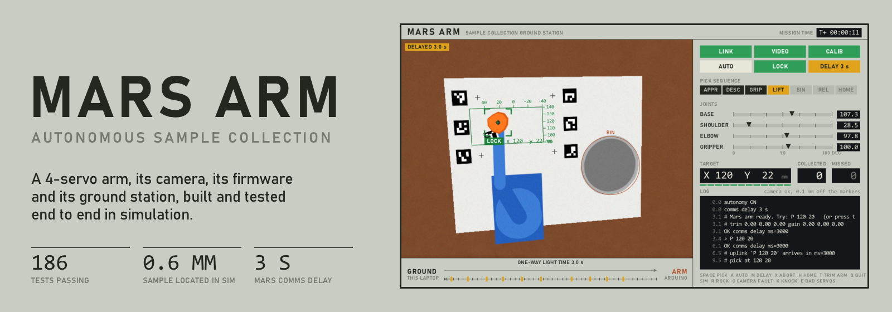
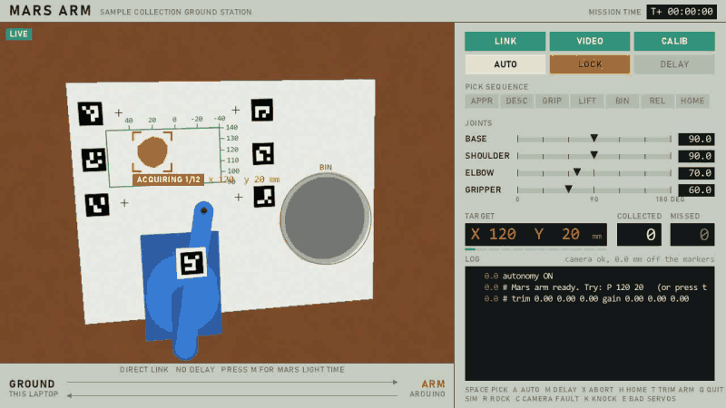
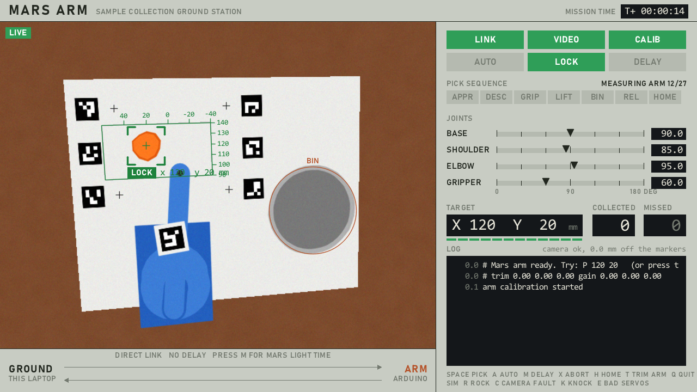
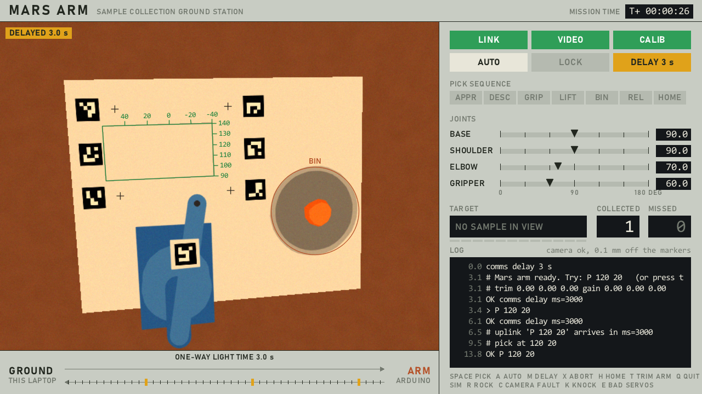
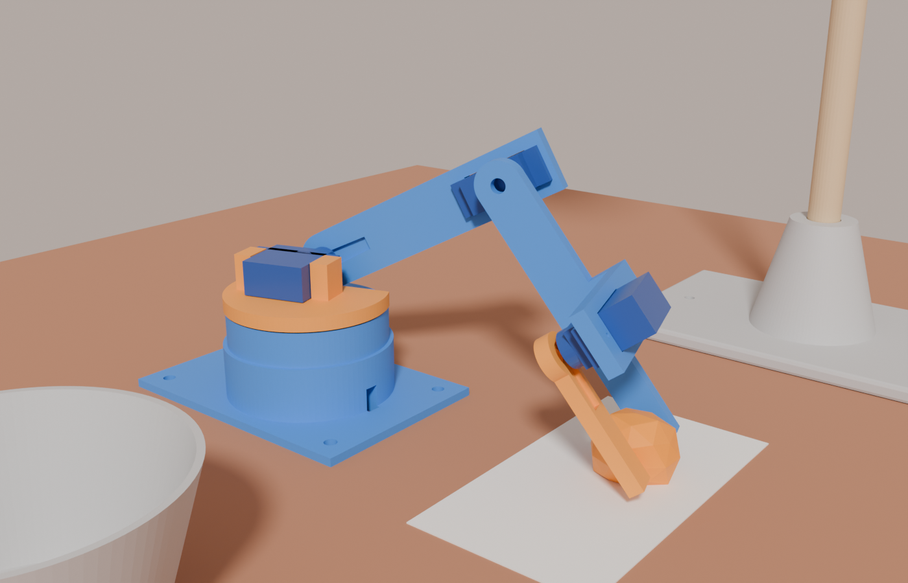
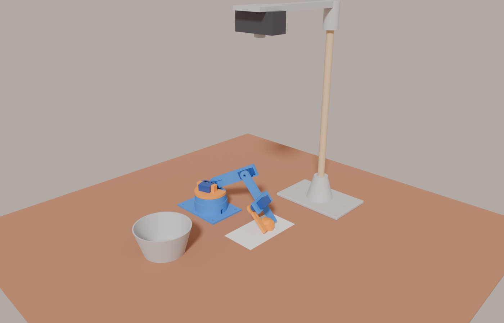
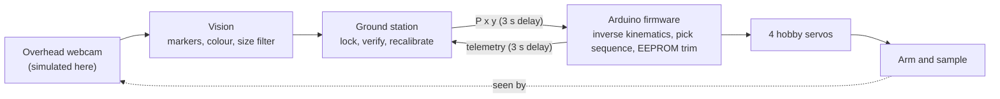

<p align="center"></p>

<p align="center">
  
  
  
  
  
</p>

# Mars Arm

A small robotic arm that **finds a rock sample with an overhead camera, picks it
up and drops it in a bin**, operated from a ground station across a simulated
**3-second Mars communication delay**. The arm, its firmware, its camera
vision and its operator console are all built, and tested end to end in
simulation. The hardware is designed (the parts are generated and
collision-checked in Blender) but not built.

<p align="center"></p>

## What makes it interesting

- **The real firmware runs in the tests.** The unmodified Arduino sketch is
  compiled for the PC and driven by the same simulated camera and ground
  station as everything else. A Python imitation of it must match its output to
  the millisecond across 40 random command streams. Building it this way
  found three real firmware bugs that a simpler simulator had hidden.
- **The camera finds the table by itself.** Six printed square markers on the
  work mat give the pixel-to-millimetre mapping, the camera's position, and a
  continuous check that nothing has moved. If the camera is knocked, the station
  notices and recalibrates before the next pick.
- **The arm calibrates its own servos.** Hobby servos are a few degrees out
  and never turn exactly 180°. Press <kbd>T</kbd> and the arm moves through 27
  poses while the camera watches a tag on the forearm; it solves for each
  joint's error and stores the fix in the Arduino's EEPROM. In simulation that
  turns a 14 mm miss into about 1 mm.
- **It does not trust itself.** A pick counts only once the camera shows the
  sample gone. It stops sending picks if the camera, its calibration or the
  arm's link goes bad, and gives up after three misses in a row.
- **The console looks like instrumentation, not a web dashboard**, and the
  Mars delay is something you can watch: commands travelling up to the arm and
  video travelling back, by how far through the 3 seconds each one is.

## Gallery

<table>
  <tr>
    <td width="50%"><br><sub><b>Calibrating the servos.</b> The camera watches the tag on the forearm through 27 poses.</sub></td>
    <td width="50%"><br><sub><b>A bad camera.</b> Warm bulb, shadow and glare, with the Mars delay on.</sub></td>
  </tr>
  <tr>
    <td width="50%"><br><sub><b>The arm.</b> Five printed parts and four micro servos, generated by a Blender script.</sub></td>
    <td width="50%"><br><sub><b>The workcell.</b> Arm, bin, sample and the camera boom.</sub></td>
  </tr>
</table>

## Try it

No arm, no camera and no printer needed.

```bash
pip install -r requirements.txt

python run.py                            # the ground station, against a simulated arm and camera
python run.py --servo-errors             # servos with real-world errors: watch it miss, press T, press A
python run.py --conditions "dim room"    # a bad camera (python robustness.py lists all 15)
python run.py --real-firmware            # drive the actual Arduino sketch, compiled for your PC
python run.py --headless 26 --auto --mars --record demo.mp4    # record a clip, no window
```

| Key | Does |
| --- | --- |
| <kbd>Space</kbd> | Pick the locked target |
| <kbd>A</kbd> | Autonomy on / off |
| <kbd>M</kbd> | Mars communication delay on / off |
| <kbd>T</kbd> | Calibrate the arm's servos with the camera |
| <kbd>X</kbd> / <kbd>H</kbd> | Abort / home |
| <kbd>R</kbd> <kbd>C</kbd> <kbd>K</kbd> <kbd>E</kbd> | Simulator: new rock, next camera problem, knock the camera, give the servos errors |

**The firmware in your browser, nothing to install:**
[open the Wokwi project](https://wokwi.com/projects/480767536940891137) and press
play. Type `P 120 20` in the serial monitor, or move the two sliders (the
sample's position) and press the green PICK button. To rebuild it yourself, paste
`mars_arm/mars_arm.ino` and `mars_arm/diagram.json` into a new Uno project and
add the Servo library.

`--real-firmware` and the firmware tests need `g++` (on Windows, inside WSL);
without it those tests are skipped.

## How it fits together



More detail on the vision, the failure handling and the calibration:
[docs/HOW-IT-WORKS.md](docs/HOW-IT-WORKS.md).

## How well does it see?

The simulated camera is a 3D pinhole view from where the boom holds it, with
15 selectable problems. Each row calibrates itself from the markers in that
condition, then locates the sample at nine positions across the pick area and
checks an empty table for false alarms. Errors are in millimetres. The gripper
tolerates about 4 mm.

| Condition | Found | Mean | Worst | Empty table |
| --- | --- | --- | --- | --- |
| Clean | 9 / 9 | 0.24 | 0.38 | ok |
| Dim room | 9 / 9 | 0.27 | 0.46 | ok |
| Overexposed | 9 / 9 | 0.20 | 0.35 | ok |
| Warm bulb | 9 / 9 | 0.25 | 0.45 | ok |
| Cold daylight | 9 / 9 | 0.24 | 0.38 | ok |
| One-sided light | 9 / 9 | 0.25 | 0.44 | ok |
| Vignette | 9 / 9 | 0.24 | 0.38 | ok |
| Soft shadow | 9 / 9 | 0.25 | 0.45 | ok |
| Glare on the sample | 9 / 9 | 0.24 | 0.38 | ok |
| Out of focus | 9 / 9 | 0.50 | 0.72 | ok |
| Noisy sensor | 9 / 9 | 0.28 | 0.49 | ok |
| Lens distortion | 9 / 9 | 0.29 | 0.43 | ok |
| JPEG artifacts | 9 / 9 | 0.33 | 0.55 | ok |
| Orange decoys nearby | 9 / 9 | 0.24 | 0.38 | ok |
| Everything at once | 9 / 9 | 0.28 | 0.41 | ok |

These numbers are against my own model of a webcam, not a real one. They show
what the method can do, not what a particular camera will.

## Project layout

| Path | What it is |
| --- | --- |
| `run.py` | The ground station |
| `groundstation/` | Vision, kinematics, station logic, console drawing, arm calibration, and the simulator |
| `mars_arm/` | Arduino firmware, Wokwi circuit and library list |
| `firmware_host/` | A stand-in for the Arduino core, so the same sketch runs on a PC |
| `cad/` | The Blender script that generates every printed part, the STLs, and the renders |
| `calibrate.py`, `tune.py` | Check what the camera sees; tune the sample's colour live |
| `make_mat.py`, `work_mat.svg` | The printable work mat with the camera markers |
| `robustness.py` | Prints the table above |
| `tests/` | 186 tests |
| `docs/` | [How it works](docs/HOW-IT-WORKS.md), [building the real arm](docs/BUILD.md), [parts list](docs/PARTS.md) |

## Testing

```bash
python -m pytest tests -n 6     # everything, about 2.5 minutes
python robustness.py            # the accuracy table above
```

- **Firmware.** The sketch and its Python imitation are fed the same commands
  and must print the same replies at the same times, and drive the servos to
  the same angles.
- **Whole system.** Every mission test runs twice, once on each firmware:
  autonomous, manual, Mars delay, abort, the corners of the pick area, five
  samples in a row through the worst camera, and every failure the station
  handles.
- **Vision.** All 15 camera conditions, plus empty-table false alarms.
- **Arm calibration.** Servos with errors make the arm miss, calibrating fixes
  it, the trim survives a power cycle, a corrupted EEPROM is ignored, and a
  missing tag puts the old trim back.
- **The printed mat.** Its markers are redrawn from the SVG and must be read
  back at the right table positions.

## Status

| | |
| --- | --- |
| Simulated | The whole pipeline: camera, vision, calibration, firmware logic, missions, failures |
| Checked in Wokwi | The sketch compiles and runs on a real AVR build; the trim commands and the fixes below behave as on the PC |
| Checked in Blender | Every part is watertight; 35 arm poses have no collisions and clear the table |
| **Not built** | Nothing has been printed, wired or run on a real arm, webcam or servo |
| **Not checked** | The vision on a real webcam, the servo calibration on real servos, whether a micro servo holds the arm steady at full reach, and the timing, memory and electrical behaviour of the firmware on a real Uno |

Building the sample's simulator this way found three firmware bugs that the
first, simpler simulator had hidden: a command arriving mid-move overwrote the
text of the one running, so an aborted pick was reported under the wrong name;
`P nan nan` drove the servos to a garbage position; and a command longer than
the buffer was cut short and run anyway. All three are fixed and tested.

## Building it

Everything works without hardware. If you do want to build it, the parts list
(about CAD $169 from Amazon.ca, with links) and the printing, assembly and wiring
notes are in [docs/BUILD.md](docs/BUILD.md).

## License

[MIT](LICENSE)
